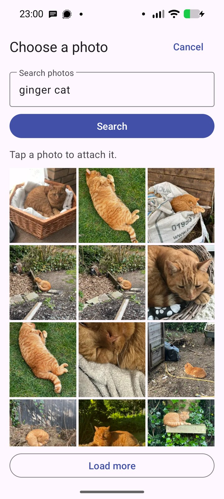

# Attachment picker

Some apps, such as WhatsApp, offer their own gallery screen with a list of other apps. The **Immich Photos** entry there opens a search screen for your Immich library and returns one original photo to the app.

This picker does not need the ADB command for the system photo picker. It uses the account you signed in with in the companion app.

## Use it from WhatsApp

1. Sign in on the companion app's main screen.
2. In a chat, choose **Attach**, **Gallery**, **Recents**, **More apps**, then **Immich Photos**.
3. Scroll recent photos, or type a search and tap **Search**. Search uses Immich smart search.
4. Tap a photo. The app downloads the original and WhatsApp opens its normal preview.

## What it does

- It registers for `GET_CONTENT` and `PICK` with `image/*`. WhatsApp only lists apps that also register `vnd.android.cursor.dir/image`, so the picker registers both.
- It loads 30 photos per page. A caller that asks for specific image types sees only photos of those types.
- It returns a read-only content URI for the selected file. The file provider is not exported and exposes only the attachment cache folder.
- It sends the original with its metadata, including GPS location when the photo has it. The screen says so.
- It removes cached originals older than 24 hours on the next selection, and refuses originals over 100 MiB.

## Limits

- One photo at a time. Videos, albums and multiple selection are not supported.
- After a rotation the search text comes back and the results reload.
- It has been tested with WhatsApp on a Pixel 8 running GrapheneOS. Other apps may need their own checks.
